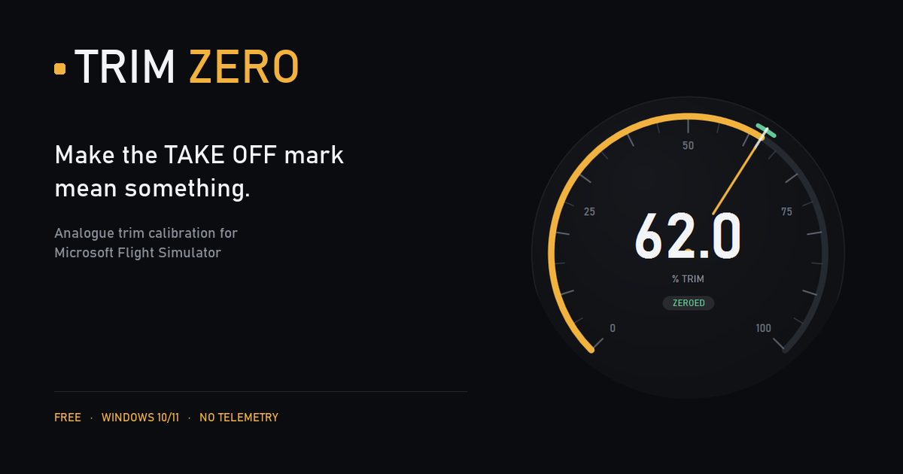
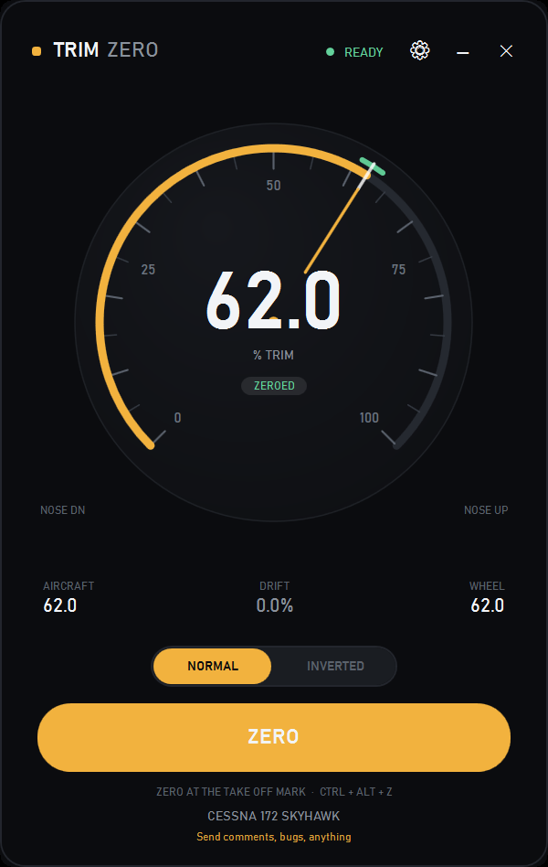
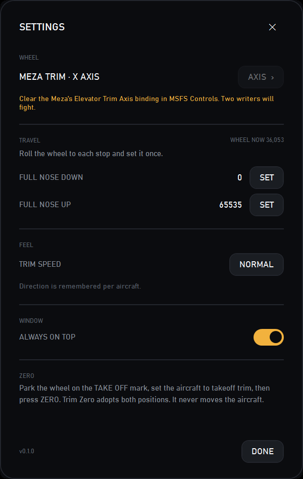

# Trim Zero

**Make the TAKE OFF mark mean something.**

Analogue trim wheel calibration for Microsoft Flight Simulator. Free, Windows 10/11,
no telemetry, no updater.

[Download the latest release](https://github.com/flyingsotong/trim-zero/releases/latest)  ·  [Source](https://github.com/flyingsotong/trim-zero)  ·  [Tip jar](https://magentadebrief.com/donate/) if it earns its place

> v0.2.2, October 2026: ZERO on the ground only, so an autopilot leg can't overwrite the
> TAKE OFF mark. Plus a direction fix and a speed cap that keeps the whole wheel useful.



## The problem

An analogue trim wheel is an absolute axis. The sim's autopilot, a reload, or a lost
control preset moves trim; the wheel does not. The next movement snaps the aircraft to
the wheel, and the physical TAKE OFF mark stops matching the aircraft.

SimTrim solved the snap by writing trim relative to the sim's live value. Trim Zero
adds the missing half: a datum for the physical mark, calibration for the wheel's short
arc, and a visible drift when the aircraft and the box disagree.

## What it does

- **Zero.** Records the wheel count at the TAKE OFF mark and the aircraft's trim. It
  writes no trim, so it cannot move the aircraft.
- **Two gains**, one either side of the mark. The top stop reaches full nose-up and the
  bottom stop reaches full nose-down, whatever the wheel's geometry.
- **Drift.** Shows when the autopilot or anything else has moved the trim away from the
  mark, and by how much.
- **Direction switch.** Normal or inverted, one tap, remembered per aircraft.
- **Per-aircraft datum.** Direction and the takeoff datum are remembered for each
  aircraft; switching back restores them without moving the aircraft.
- **Autopilot clutch.** The wheel is inert while the autopilot is flying; on disconnect
  the control reseeds but the datum is kept, so the mark does not silently lie.
- **Start with Windows.** Optional; starts minimized and waits for MSFS. No service, no
  admin, no tray.
- One 400 x 632 window. No tray, no updater, no telemetry, no network.

## Screenshots






## Supported wheels

Any manual trim wheel that appears as a DirectInput axis. The Meza Trim is the tested
device; Trim Zero lists every attached game controller under **DEVICE**, so Saitek /
Logitech, Desktop Pilot and DIY wheels can be selected too. It does not assume the wheel
is a Meza.

Not supported: encoder wheels such as the Honeycomb Bravo or Sierra. They send button
steps, not an axis.

## Install

1. Download the [latest release](https://github.com/flyingsotong/trim-zero/releases/latest)
   zip.
2. Install the [.NET 8 Desktop Runtime](https://dotnet.microsoft.com/download/dotnet/8.0)
   if it is not already present.
3. Run `TrimZero.exe`. The executable is unsigned, so Windows SmartScreen may warn on
   first run.

## Verify the download

Each release note carries the SHA256 of its zip. To check a download:

```powershell
Get-FileHash .\TrimZero-0.1.0-win-x64.zip -Algorithm SHA256
```

Compare it with the hash in the [release notes](https://github.com/flyingsotong/trim-zero/releases/latest).
Substitute the file name you actually downloaded.

## Setup

1. In MSFS Controls, clear your wheel's **Elevator Trim Axis** binding. Two writers will
   fight if the sim still binds the axis.
2. In Trim Zero's settings, choose your wheel under **DEVICE**, then the trim axis under
   **AXIS**. The app auto-detects a device named Meza or Trim; anything else is one
   click away.
3. Start the sim and load a flight.
4. In settings, roll to full nose-down and press **SET**; roll to full nose-up and press
   **SET**. This measures the wheel's real stops.
5. Set the aircraft to takeoff trim, park the wheel on the TAKE OFF mark, press
   **ZERO**.
6. Fly. ZERO re-datums at any time; the drift tells you when to.

## How it writes trim

It writes `ELEVATOR TRIM POSITION` in radians, always from the sim's live value plus a
delta. It never writes the wheel's absolute angle. On the C172, `ELEVATOR TRIM PCT` is
readable but a data write is ignored; POSITION is the control.

## Build

- .NET 8 SDK
- The two x64 SimConnect files in `lib/`; see [lib/README.md](lib/README.md)
- `dotnet build -c Release`

## Status

v0.2.2, October 2026. Verified against MSFS 2024 with the Meza in the C172: a ground
ZERO records the mark, an in-flight ZERO leaves the takeoff datum and the saved count
alone, and a reload restores the band. Two full flights with the app as the only writer,
in and out of the autopilot, with no pitch change on disconnect. The A32 Vixxen path and
the return to the C172 work, with the per-aircraft datum and direction restored. The
Meza is the tested wheel; other DirectInput analogue wheels are selected under DEVICE
and AXIS, and reports are welcome. Start with Windows is implemented and the
minimized/single-instance path is tested; the full logout/login cycle isn't. Other
aircraft use the same neutral and limit variables; please report differences.

## Privacy

No network, no telemetry, no updater. Settings live in
`%LOCALAPPDATA%\TrimZero\settings.json`. The only outbound action is the feedback link,
which opens your mail client.

## Support

Trim Zero is free, with no telemetry and no upsell. If it saved you a bad flight, you
can leave something in the tip jar: https://magentadebrief.com/donate/

## License

MIT. Not affiliated with Meza or Microsoft. Trim Zero is a Magenta Debrief project.

## Feedback

alan@magentadebrief.com

---

<p align="center">
  <a href="https://magentadebrief.com">
    <picture>
      <source media="(prefers-color-scheme: dark)" srcset="docs/magenta-lockup-dark.png">
      
    </picture>
  </a>
</p>

The Magenta Debrief name and logo are trademarks of Magenta Debrief and are not covered
by the MIT licence.
